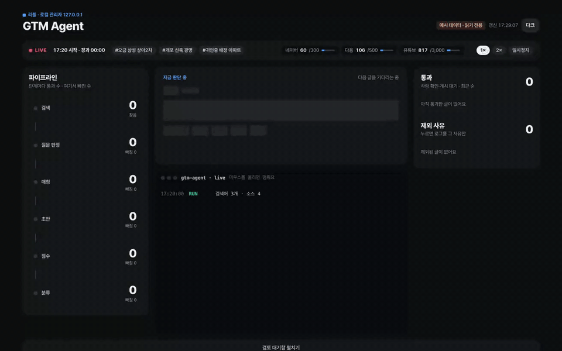
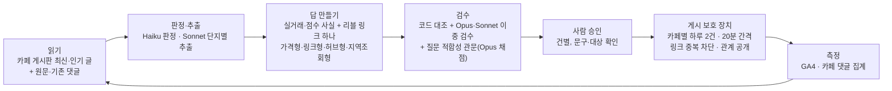

# REEVL GTM Loop

[](docs/media/console.mp4)

**부동산 질문에 데이터로 먼저 답하는 AI + 사람 승인 루프**

[Clone Loop Day in Seoul](https://luma.com/a1bags64) (2026-10-24, NAVER D2SF · Agentic GTM) 출품작 · 서비스 https://reevl.co.kr

광고를 뿌리는 대신, 사람들이 이미 묻고 있는 부동산 질문에 실거래 데이터로 먼저 답하고 리블 링크를 곁들입니다.
게시는 자동이 아니라 **사람이 건별로 승인**합니다.

## 7일 결과 (10/24 ~ 10/31 17:36 KST)

| 항목 | 결과 |
|---|---|
| 게시 | 부동산스터디 댓글 **12건** (관계 공개 12/12, 사람 승인 12/12, 광고비 0) |
| 유입 | 댓글 링크로 **80세션**(신규 78), 단지 상세 44회, 비교 기능 141회 |
| 참여 | 참여율 **90%**(같은 기간 사이트 69%), 세션당 PV **7.0**(사이트 2.40) |
| 반응 | 우리 댓글에 달린 답글 **3/11**, 모두 원글 작성자의 감사·긍정 · 정정 요청 0 · 댓글 유지 11/12 |
| 개선 | 루프 기록 31회차. 사후 채점으로 약점(질문 적합성 2.0/5)을 찾아 게시 전 관문으로 반영 |
| 비용 | Claude API 약 $12 (크레딧 $100 중) |

측정: GA4 사람 필터(데이터센터·중국 봇·이상 해상도 제외), 댓글 링크(`/c/키`)가 여는 비교 화면에 착지한 세션.
정의와 한계는 [품질·신뢰 지표](docs/09-quality-trust-metrics.md)에 분자/분모와 함께 적었습니다.

### 목표 대비 (10/24 제출 목표 그대로)

| 목표 | 기준값 → 목표 | 실제 | 판정 |
|---|---|---|---|
| 매일 '본 것 → 바꾼 것' 기록 | — | 31회차([docs/07](docs/07-loop-log.md)) | 달성 |
| Agent 추적 착지 세션 | 0 → 100+ | 80 | 미달 |
| 네이버 밖 유입 | 주 66 → 500+ | 변화 없음 (카페 유입은 네이버 채널로 집계돼 이 지표에 안 잡힘) | 미달 |
| 재방문율 | 3.8% → 6% | 측정 불가 (재방문 세션 1) | 판정 불가 |
| 사람 검수 필요 비율 | → 20% 이하 | 미측정 | 판정 불가 |
| 정책 위반·삭제 | 0 | 원글 1건 삭제, 원인 불명 | 단정 안 함 |

사이트 전체 세션이 같은 기간 +37% 늘었지만 대부분 네이버 검색이라 GTM 성과로 세지 않았습니다.

## 루프



1. **읽기**: 로그인된 브라우저(Aside)로 카페 게시판 목록과 글 원문·댓글·댓글 권한을 읽는다. 삭제·미가입·등급 제한 글은 검수 전에 뺀다(`agent/board.py`, `agent/reader.py`).
2. **판정·추출**: Haiku가 질문인지·적절한지 판정하고, Sonnet이 단지별 이름·별칭·지역을 뽑는다. 표기 차이를 흡수해 리블 단지와 맞춘다(`agent/judge.py`, `agent/match.py`).
3. **답 만들기**: 글쓴이가 말한 평형 기준 실거래(가격형), 단지·허브 페이지와 리블이 가진 사실(링크형·허브형), 지역 단지 조회(지역조회형). 두 줄, 괄호·날짜 없이, 둘째 줄에 관계 공개(`agent/reply.py`).
4. **검수**: 수치·날짜·공개·형식·링크 대상을 코드로 대조하고, Opus·Sonnet이 원문·기존 댓글을 읽고 독립 판정한다(둘 다 통과해야 통과). 마지막으로 Opus가 질문 적합성을 채점해 3점 미만은 뺀다.
5. **사람 승인 → 게시**: 문구와 대상 글을 보고 건별 승인한다. 자동 게시는 기본 꺼져 있다(`GTM_AUTOPUBLISH`).
6. **측정**: 댓글 링크가 여는 비교 화면 착지 세션(GA4), 댓글 유지·답글·작성자 반응(`agent/outcomes.py`).

## 개선 과정 (대표 5건, 전체는 [루프 기록](docs/07-loop-log.md))

| 본 것 | 바꾼 것 |
|---|---|
| 검수가 검색 요약만 보고 오답을 통과시킴 | 원문·기존 댓글을 읽는 Opus·Sonnet 이중 검수. 평가 세트 오답 34/34 차단 |
| 미가입 카페라 게시 단계에서 막힘 | 가입 여부(`isCafeMember`)를 읽어 게시 전에 거름 |
| 표기 차이로 단지 매칭 실패 48건 | 단지별 이름·별칭·지역 추출, 표기 키. 사람 확정 6건 중 4건 자동 정답 |
| 글을 하나씩 처리해 109건에 10분 | 동시 처리로 257건 2분 |
| 게시한 11건을 채점하니 **질문 적합성 평균 2.0/5** (같은 계열 모델 채점) | 같은 채점표를 게시 전 관문으로 이동. 관문 뒤 약 80건 재검토에서 후보 0 → 병목은 답 생성이 아니라 '데이터로 답할 수 있는 질문'의 공급 |
| 하루 7건 게시로 도배 위험 | 카페별 하루 2건 · 20분 간격 · 링크 중복 차단 장치 |

## 안전 원칙

- **관계 공개**: 모든 댓글에 "제가 운영하는 리블에 … 정리해 뒀어요"를 쓴다. 표시광고법 추천·보증 심사지침의 이해관계 공개 대상이다. 공개 없이 일반 사용자처럼 쓰는 기능은 만들지 않는다.
- **사람 승인**: 자동 게시 기본 꺼짐. 게시 직전에 원글 생존·댓글 권한·기존 링크 유무를 다시 확인한다.
- **규칙 확인한 카페만**: 게시한 곳은 부동산스터디 한 곳이다. 등급 제한·CAPTCHA·가입 제한을 우회하지 않는다. 읽기 레벨이 부족한 글은 후보에서 뺀다.
- **쓰지 않는 말**: AI 전망·순위·호가·'오른다' 단정·매수 추천·학교 배정 확정.
- **삭제·경고가 생기면 그 채널을 멈춘다.** 체크리스트와 알려진 구멍은 [정책 체크리스트](docs/10-policy-checklist.md).

## 한계

- 표본 12건, 카페 1곳. 비율은 방향만 보여 준다.
- 사후 채점은 같은 계열 모델이 했다(독립 검증 아님).
- 지속 유입(D2 이후 10/53)은 비교 화면 주소로 센 추정이다.
- 카페 유입은 GA4 채널상 네이버로 묶여 '네이버 밖 유입' 목표에 들어가지 않는다.
- 추천·전망형 질문은 우리 데이터로 답할 수 없어 게시 후보가 거의 나오지 않았다.

## 실행

Python 3.11 이상, 표준 라이브러리만 쓴다. 비밀값은 이 저장소에 없고 실행할 때 환경 변수 또는 리블 본체 `.env`에서 이름 하나씩 읽는다([.env.example](.env.example)).

```bash
git clone https://github.com/exclusiveyon-a11y/reevl-gtm-loop && cd reevl-gtm-loop
python -m agent reply --qa --text "송파구 오금동 삼성이랑 상아2차 중에 실거주로 고민입니다"   # 키 없이 초안만
python -m unittest discover -s tests                                                         # 단위 테스트
```

| 명령 | 하는 일 | 필요한 것 |
|---|---|---|
| `python -m agent reply --text "…"` | 글 한 개 → 리블 링크 달린 답글 초안 | 없음 |
| `python -m agent compare <cid> <cid>` | 단지 2~3개 → 같은 면적대 비교 근거 | 없음 |
| `python -m agent.board --cafe <주소> --hours 72 [--retry]` | 가입한 카페 게시판을 읽어 답글 후보 만들기(게시 안 함) | Aside 로그인, Claude 키 |
| `python -m agent.outcomes` | 올린 댓글의 유지·답글·작성자 반응(분자/분모) | Aside 로그인 |
| `python analysis/ga_persistence.py` | 댓글별 D0~D5 유입 | GA4 읽기 자격 |
| `python analysis/ga_report.py` | 캠페인·사이트 지표(같은 사람 필터) | GA4 읽기 자격 |
| `python analysis/quality_eval.py` | 올린 댓글 6항목 사후 채점 | Claude 키 |
| `python -m agent.admin` | 로컬 관리자 화면(127.0.0.1:8799, 공개 배포 안 함) | 없음 |

## 문서

| | |
|---|---|
| [docs/07-loop-log.md](docs/07-loop-log.md) | 루프 개선 기록 31회차 (본 것 → 바꾼 것) |
| [docs/09-quality-trust-metrics.md](docs/09-quality-trust-metrics.md) | 품질·신뢰 지표(분자/분모), 사후 채점, 비용·사람 개입 |
| [docs/10-policy-checklist.md](docs/10-policy-checklist.md) | 정책 준수 체크리스트와 알려진 구멍 |
| [docs/05-agent.md](docs/05-agent.md) | 에이전트 구조·모듈·큐 필드 |
| [docs/04-measurement.md](docs/04-measurement.md) · [docs/01-baseline.md](docs/01-baseline.md) | 지표 정의·UTM 규칙 · 기준값(10/24 조회) |


[데모 영상 (MP4, 19초)](docs/media/console.mp4) · 예시 데이터로 녹화한 데모 모드(`python -m agent.admin --demo`). 실제 실행 화면은 커뮤니티 글 제목이 담겨 공개하지 않는다.

## 크레딧

- 데이터: [리블](https://reevl.co.kr) 공개 MCP API(국토교통부 실거래가 등 공공데이터 기반)
- 판정·추출·작성·검수·채점: Claude Haiku 5.5 · Sonnet 5.5 · Opus 5.5 (Messages API, 하루 $8 · 총 $98 상한)
- 게시·읽기: Aside 브라우저 CLI
- 행사: Clone Loop Day in Seoul (Clone, OpenAI, NAVER D2SF, Deepest)
